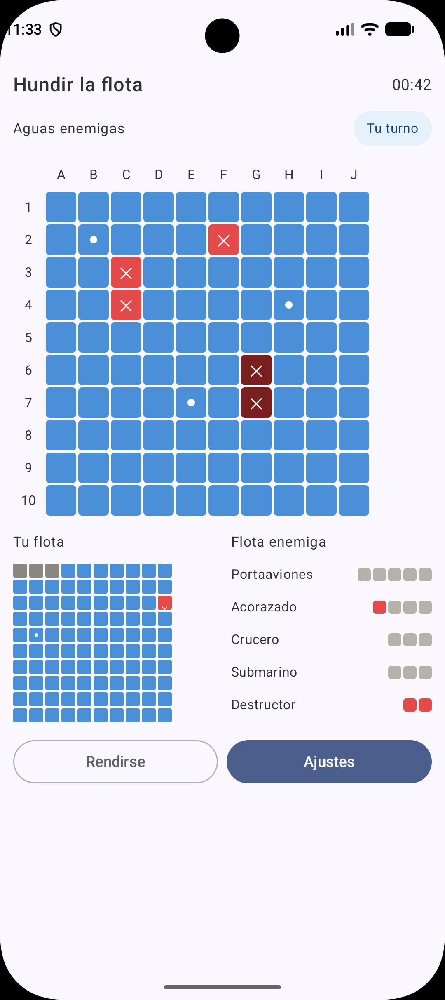

# ProyectoMaqueta · Hundir la flota

Maqueta de la pantalla de juego de **Hundir la flota** para Android, desarrollada como proyecto de clase de DAM2.

> Es un prototipo visual: **no tiene lógica de juego**. Los estados de las casillas (agua, fallo, tocado, hundido) y los barcos son datos fijos de ejemplo para mostrar cómo se vería una partida. Los botones se ven, pero no hacen nada.

## Capturas

<!-- Guarda tus capturas en la carpeta /screenshots y ajusta el nombre del archivo -->
| Pantalla de juego                                 |
|---------------------------------------------------|
|  |

## Qué incluye la pantalla

- Cabecera con el título y el temporizador.
- Indicador de turno ("Tu turno").
- Tablero enemigo de 10x10 con coordenadas (A-J y 1-10).
- Tablero propio reducido, con los barcos colocados.
- Estado de la flota enemiga (portaaviones, acorazado, crucero, submarino y destructor).
- Botones "Rendirse" y "Ajustes".

### Estados de las casillas

| Estado | Aspecto |
|---|---|
| Agua | Azul |
| Fallo | Azul con un punto blanco |
| Tocado | Rojo con una X |
| Hundido | Rojo oscuro con una X |
| Barco propio | Gris |

## Tecnologías

- Android Studio
- Kotlin
- Jetpack Compose (Material 3)

## Cómo ejecutarlo

1. Clona el repositorio:
   ```bash
   git clone https://github.com/TU_USUARIO/TU_REPOSITORIO.git
   ```
2. Abre la carpeta del proyecto en Android Studio.
3. Espera a que termine la sincronización de Gradle.
4. Ejecuta la app en un emulador o en un dispositivo físico.

## Estructura del código

```
app/src/main/java/com/sergio/proyectomaqueta/
├── MainActivity.kt          # Punto de entrada: muestra la pantalla
└── composables/
    ├── Casilla.kt           # Casilla individual y sus estados (EstadoCasilla)
    ├── Tablero.kt           # Tablero 10x10 reutilizable (grande y pequeño)
    └── Pantalla.kt          # Pantalla de juego completa
```

### Cómo está construido

- **`Casilla`**: una casilla cuyo color y símbolo dependen de su estado y que se adapta al tamaño que reciba.
- **`Tablero`**: se reutiliza para el tablero enemigo (grande, con coordenadas) y para el propio (pequeño, sin coordenadas). Recibe un mapa con las casillas especiales; el resto es agua.
- **`Pantalla`**: junta cabecera, turno, tableros, estado de la flota y botones.

## Autor

- **Nombre:** Sergio
- **Curso:** DAM2
